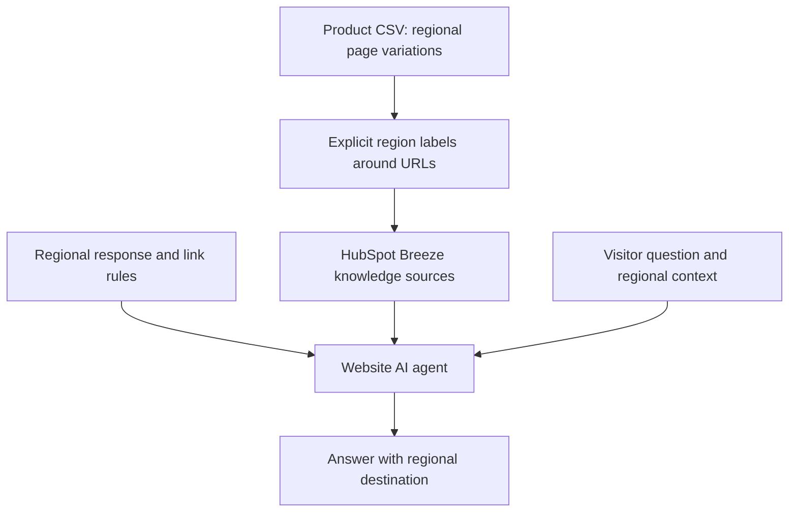
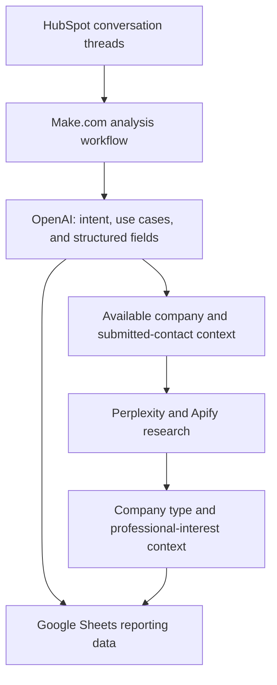
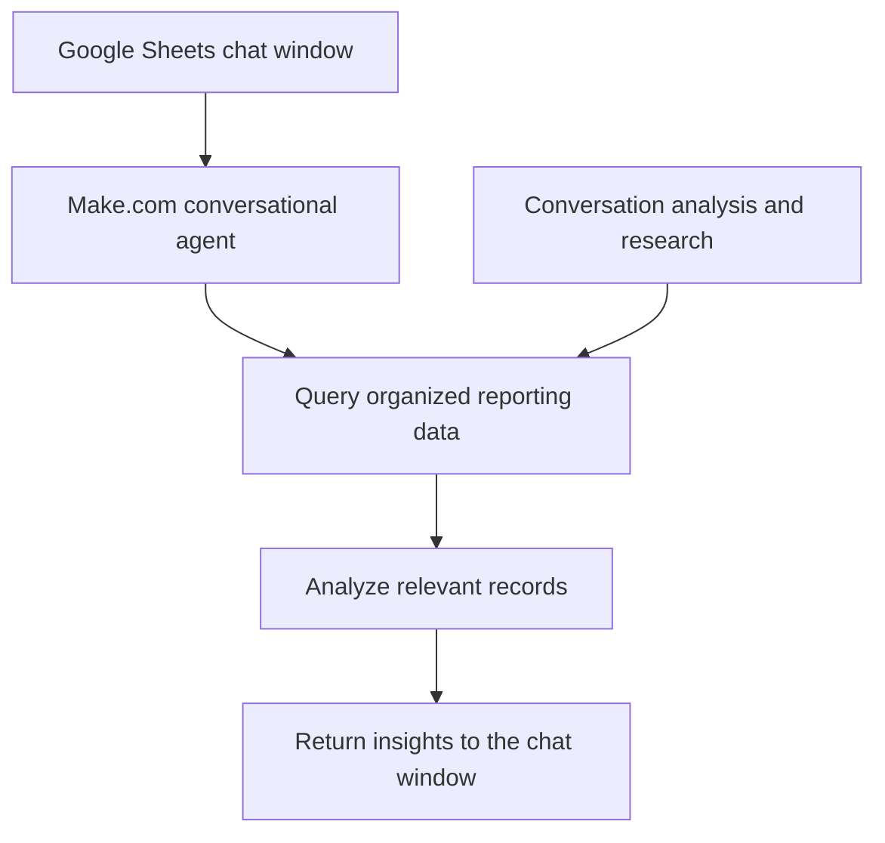
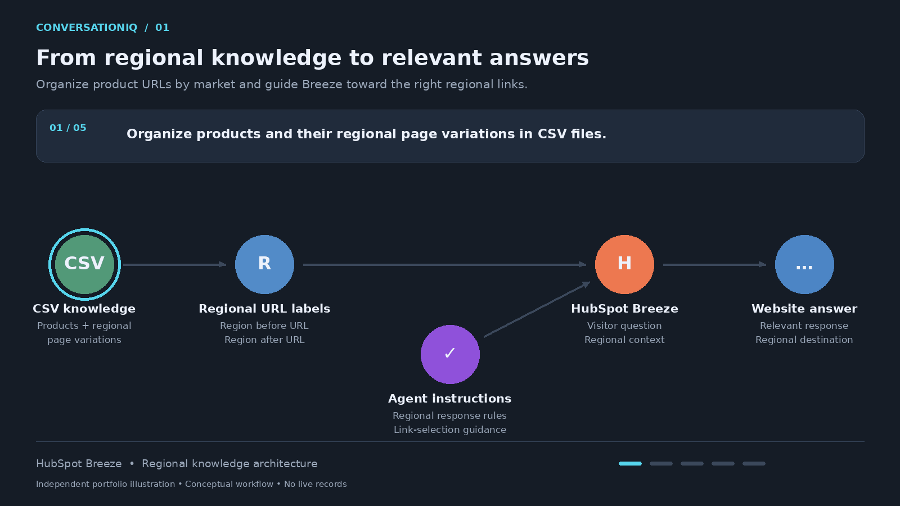
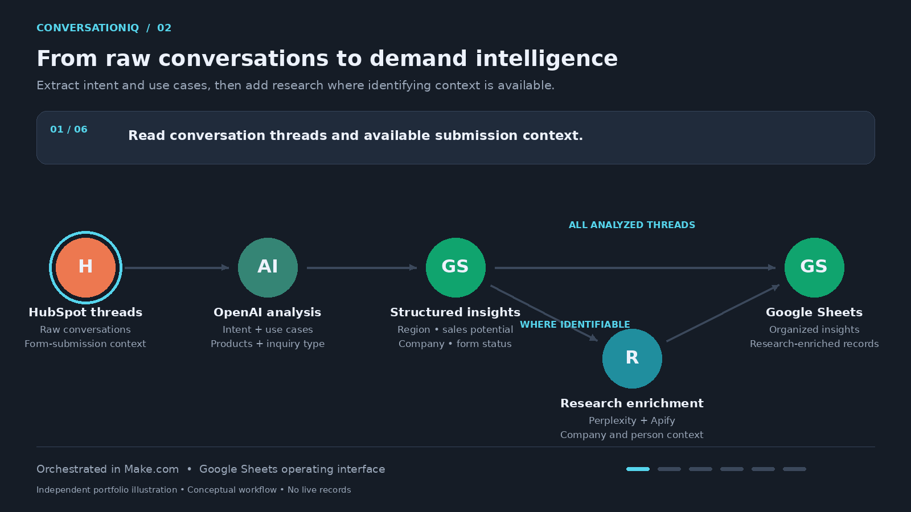
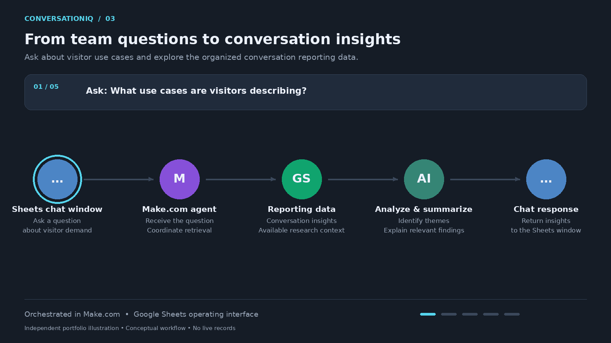

# ConversationIQ
### Regional AI Chat, Conversation Analysis & Conversational Reporting

**Answer visitors → understand demand → ask questions of the data**

**Production experience:** All three components are live, as reported by the builder.  
**Portfolio status:** Case-study overview, conceptual diagrams, and three animated workflow walkthroughs available. A manually authored fictional input-to-insight example is included below; interactive interface demonstrations remain planned.

## The Business Problem

A global website AI agent needs to answer accurately and direct visitors to the correct regional pages. Product names alone may not distinguish the appropriate destination when the same product appears across multiple markets.

The conversations also contain valuable information: what visitors want to achieve, which products they mention, what projects they describe, and whether they submit a form. Raw threads are difficult for a marketing team to review at scale.

ConversationIQ presents three connected capabilities: regional knowledge-base design, automated conversation analysis and research, and a chat interface for exploring the resulting data.

## My Role

I configured the HubSpot Breeze website agent, built its CSV knowledge sources and regional instructions, and developed both the conversation analysis workflow and the reporting chat interface.

I built the supporting workflows in Make.com, using OpenAI for analysis, Perplexity and Apify for company and person research, and Google Sheets for organized data and the custom chat window.

My responsibilities covered knowledge architecture, regional response guidance, workflow implementation, structured analysis, research enrichment, and the reporting interface.

## 1. Regional Website AI Agent

### Region-Aware Knowledge Design

I structured CSV knowledge sources to associate each product with its regional page variations.

Each URL entry has explicit region labels before and after the link. This gives the agent repeated local context for distinguishing otherwise similar product destinations. I reinforced that structure with region-specific agent instructions governing responses and link selection.

| Layer | Implementation | Purpose |
|---|---|---|
| Knowledge organization | Product records include regional page variations. | Keep related destinations together. |
| URL context | Region labels appear before and after each URL. | Make the intended market explicit during retrieval. |
| Agent instructions | Region-specific response and link-selection rules. | Guide the agent toward the appropriate regional destination. |

I implemented this approach and found it effective in operation. No measured retrieval-accuracy rate is claimed in this case study.

### Conceptual Knowledge Flow

Breeze provides the website customer agent. My contribution was configuring it and designing the knowledge and instructions that support regional responses.

## 2. Conversation Analysis & Research Agent

Make.com and OpenAI turn raw conversation threads into structured reporting data.

The analysis captures both the subject of the conversation and the use case the visitor describes, helping the team understand demand beyond product-name counts.

| Analysis dimension | Information organized |
|---|---|
| Region | Regional context of the inquiry |
| Inquiry type | The category of request |
| Conversation intent | What the visitor is trying to accomplish |
| Use cases | The applications or projects described in the conversation |
| Product interest | Products mentioned |
| Company | Available company information |
| Sales potential | AI-assisted assessment for internal review |
| Form submission | Whether the visitor submitted a form |

### Company & Person Research

Perplexity and Apify add research context where the available company and submitted-contact information supports it.

Company research examines the type of organization, including whether it is a system integrator and the kind of integration work it performs. Person research examines available job-title, project, and LinkedIn posting information to understand professional interests.

These research profiles support inbound marketing decisions and help the team connect expressed use cases with relevant company and person context.

This is research enrichment of available records, not a claim to identify every anonymous website visitor. The case study does not establish an identity-resolution method for visitors without sufficient identifying information.

### Conceptual Analysis Flow

AI-generated classifications and researched context are assessments rather than independently verified facts.

## 3. Conversational Reporting Interface

I built a custom chat window in Google Sheets, connected to a Make.com agent, so users can interact with the reporting data through natural-language questions.

The interface supports insight questions, especially around the applications visitors describe and how they intend to use the devices.

Illustrative questions include:

- What use cases appear most often in the conversations?
- What applications are visitors describing for a particular product?
- What themes emerge from system-integrator inquiries?

These are examples of the intended reporting questions, not published test results. This case study describes retrieval, analysis, and summaries; data-editing actions are outside the documented scope.

### Conceptual Question-to-Insight Flow

## Fictional Example: From Inquiry to Insight

**Manually authored illustration—not a production transcript, live enrichment result, or executed agent response.** All names, products, and records below are invented.

### Input: A Visitor Inquiry

> “I'm Maya, a project manager at Northbridge Integration. We integrate maintenance systems for water utilities. We're looking at the TerraForge FieldBook for technicians inspecting pump stations. Can it be used with gloves in wet conditions? Please send me the UK product page. I'd like someone to contact me about a pilot.”

For this example, assume a UK chat context and a submitted contact form.

### Structured Analysis

| Field | Illustrative value | Basis |
|---|---|---|
| Region | UK | Assumed chat context and explicit link request |
| Inquiry type | Product suitability and sales inquiry | Questions about operating conditions and a pilot |
| Conversation intent | Evaluate a device for a field pilot | Explicitly stated |
| Use case | Pump-station inspections by maintenance technicians | Explicitly stated |
| Product mentioned | TerraForge FieldBook | Fictional product named in the inquiry |
| Operating requirements | Gloves and wet conditions | Requirements to investigate, not confirmed product capabilities |
| Company | Northbridge Integration | Fictional company supplied by the visitor |
| Company type | Possible system integrator | Visitor describes integration work; research would be needed to confirm |
| Person / role | Maya / project manager | Visitor-supplied information |
| Sales potential | Pilot inquiry for sales review | Illustrative assessment, not a proprietary scoring rule |
| Form submission | Yes | Assumed example event |

The regional knowledge design helps guide selection of a UK destination. Product-suitability questions require supporting knowledge; the inquiry itself is not evidence that the device meets those requirements.

### Research Handoff

The company name and submitted-contact information provide a starting point for research. The workflow can investigate the organization's integration specialties and available professional profile information.

No LinkedIn posts, personal interests, or external research findings are invented here. If those sources are unavailable, the example remains incomplete rather than presenting unsupported details as facts.

### Reporting Question & Illustrative Answer

**Question:** “What use cases are UK visitors describing?”

**Example answer:** “In this single sample record, the visitor describes pump-station inspections by utility maintenance technicians. The stated requirements include glove use and wet conditions, and the visitor requests contact about a pilot.”

One record illustrates how a conversation becomes usable reporting context. It does not establish a trend or a real-world performance result.

## Technology Roles

| Technology | Role |
|---|---|
| HubSpot Breeze | Regional website AI customer agent |
| CSV knowledge files | Product and regional URL organization |
| Make.com | Conversation-analysis orchestration and reporting-agent backend |
| OpenAI | Structured conversation analysis and AI-supported reporting |
| Perplexity | Company and person research support |
| Apify | Supporting company and professional-profile data collection |
| Google Sheets | Organized reporting data and custom chat interface |
| Google Apps Script | Custom interface development |

## Operational Outcome

All three components are live: the configured website agent, the conversation-analysis and enrichment workflow, and the Google Sheets reporting chat.

The system connects visitor assistance with structured demand intelligence and a conversational way for the team to explore that intelligence. The resulting insights help inform inbound marketing, particularly around visitor use cases and professional interests.

No numerical claims about conversion lift, analyst time saved, classification accuracy, or link-retrieval accuracy are made here.

## Animated Workflow Walkthroughs

These independent animations illustrate the capabilities at a conceptual level. They contain no production records, visitor conversations, internal screenshots, or proprietary configurations.

### 1. Regional Knowledge & Link Selection

CSV knowledge sources organize product page variations by region. Explicit labels around URLs and regional agent instructions guide HubSpot Breeze toward relevant answers and regional destinations.

### 2. Conversation Analysis & Research

OpenAI turns raw threads into structured intent, use-case, product-interest, and inquiry data. Where identifying context is available, Perplexity and Apify add company and professional-interest research. The organized results are stored in Google Sheets.

### 3. Conversational Reporting

A question entered through the custom Google Sheets chat window passes to the Make.com agent. The workflow retrieves relevant reporting records, analyzes themes, and returns insights to the chat interface.

## Planned Portfolio Assets

Independent assets will use fictional products, synthetic conversations, and invented company and contact records:

1. A fictional regional knowledge-source example.
2. An executed synthetic conversation-analysis demonstration complementing the manually authored example.
3. A reporting-chat interface demonstration with sample use-case questions.
4. A small synthetic dataset showing company type and research context.

These assets will illustrate the capabilities without publishing production CSVs, raw visitor conversations, internal prompts, personal records, or employer-specific configuration.

## Portfolio Disclosure

ConversationIQ is an independent portfolio name for this case study. The operational experience described is distinct from the planned public demonstration.

Conceptual diagrams summarize the capabilities and do not reproduce internal scenarios or proprietary configuration. Employer records, credentials, customer information, internal instructions, and confidential implementation details are excluded.

[Back to portfolio](../../README.md)
