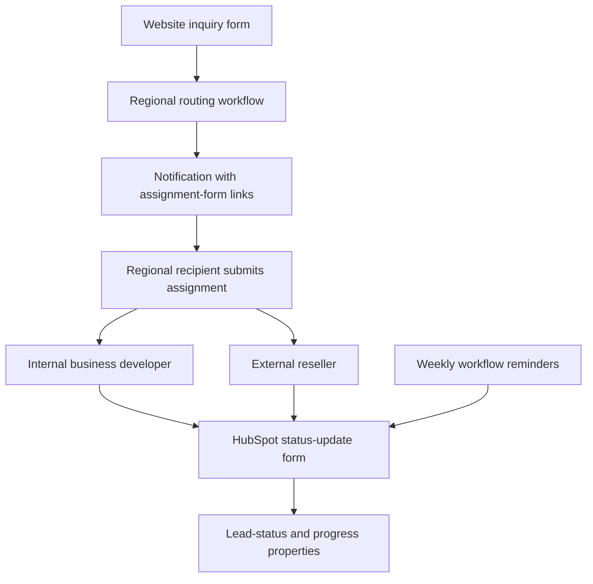
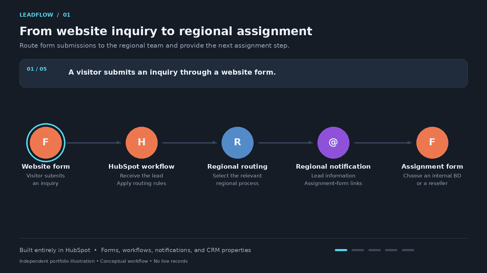
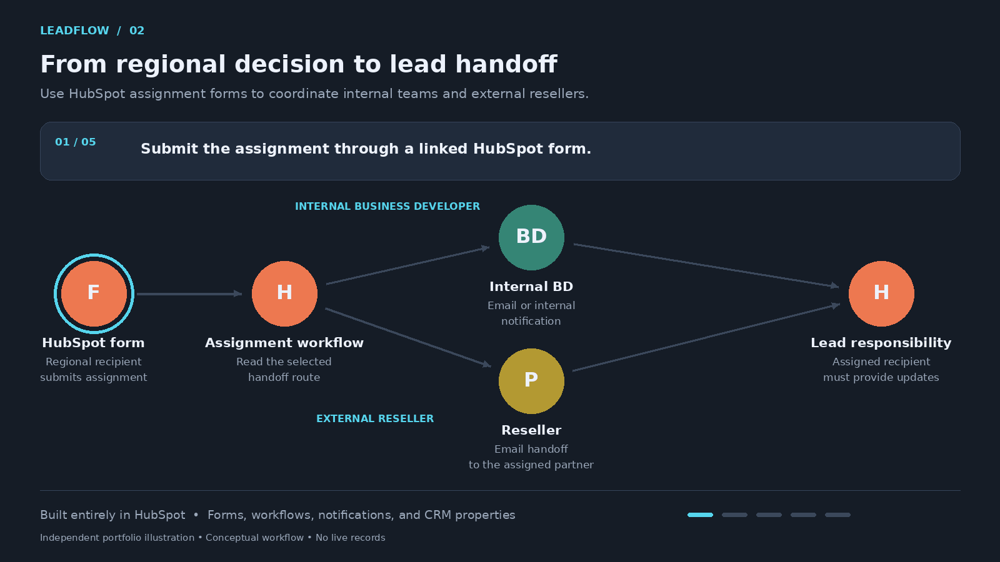
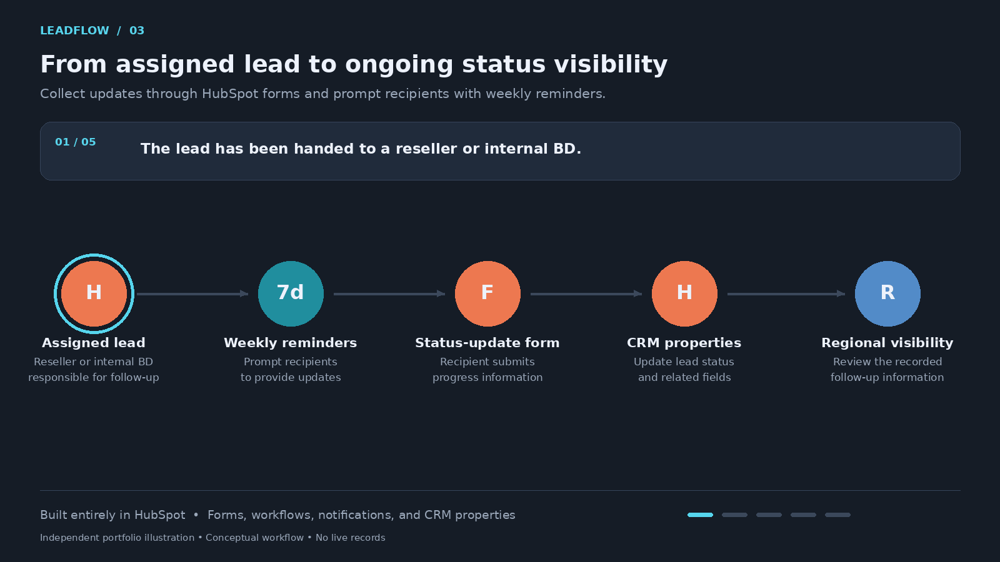

# LeadFlow
### Regional Lead Assignment & Follow-Up Automation

**Website inquiry → regional routing → assignment → status updates → weekly reminders**

**Platform:** HubSpot  
**Portfolio assets:** Three animated conceptual walkthroughs and a written fictional inquiry-to-update example. No live customer records or internal configurations are included.

## The Business Problem

A website inquiry needs a clear path from submission to the person responsible for follow-up. In a regional sales model, that person may be an internal business developer or an external reseller.

The handoff is only part of the process. Regional teams also need a consistent way to request and collect progress updates after the lead has been assigned.

## My Role

I built HubSpot lead-handling workflows that connect website inquiries, regional routing, assignment forms, notifications, status-update forms, and weekly reminders.

The workflow coordinates regional recipients, internal business developers, and external resellers through HubSpot forms and CRM properties.

## Workflow Overview

| Stage | What happens |
|---|---|
| Website inquiry | A visitor submits a form on the website. |
| Regional routing | HubSpot routes the inquiry according to regional rules. |
| Regional notification | The recipient receives lead information and links to HubSpot assignment forms. |
| Assignment | The regional recipient uses a form to assign the lead to an internal business developer or reseller. |
| Handoff | The assigned recipient receives an email or internal notification, depending on the route. |
| Status reporting | The reseller or business developer submits status and progress updates through another HubSpot form. |
| CRM update | Submitted information updates lead-status and related properties. |
| Weekly reminders | Workflow reminders prompt recipients to provide updates. |

All of these capabilities are implemented in HubSpot using forms, workflows, notifications, and CRM properties.

## Conceptual Architecture

This diagram summarizes the process without reproducing internal routing conditions or configuration.

## Animated Workflow Walkthroughs

The animations use independently created graphics and conceptual labels. They do not contain production screenshots, real lead data, internal forms, or proprietary rules.

### 1. Website Inquiry & Regional Routing

A website form submission enters HubSpot. Regional rules determine the next process, and the regional recipient receives a notification with links to the assignment forms.

### 2. Assignment & Handoff

The regional recipient submits an assignment form. The workflow follows the selected internal-business-developer or reseller route and notifies the assigned recipient.

### 3. Status Updates & Weekly Reminders

Recipients submit progress through a HubSpot form, updating status and related CRM properties. Weekly reminders prompt further updates and support regional visibility into follow-up.

## Fictional Example: From Inquiry to Follow-Up Update

**Manually authored illustration.** Companies, people, regions, statuses, and CRM field labels below are synthetic. No form submission, notification, workflow execution, or CRM update occurred. These are example labels, not employer property names.

### Inquiry & Regional Assignment

| Stage | Sample record or decision |
|---|---|
| Lead reference | DEMO-LEAD-001 |
| Company | Harborline Water Services — fictional |
| Website inquiry | “We would like to discuss devices for field inspections.” |
| Region | Region West — fictional |
| Routing result | Notify the Region West coordinator. |
| Notification content | Inquiry summary and links to the internal-BD and reseller assignment forms |
| Assignment submission | Coordinator selects the reseller route and chooses Northbridge Field Partner — fictional. |
| Handoff | The selected reseller receives an email with the lead information and status-update step. |

This example follows one regional path. It does not reproduce a real routing rule, partner roster, or internal notification template.

### Status-Update Form

| Example form field | Sample submitted value |
|---|---|
| Lead reference | DEMO-LEAD-001 |
| Follow-up status | Contact attempted |
| Progress note | Introductory message sent; awaiting a response. |
| Next action | Follow up to arrange a discovery call. |

The form submission updates the corresponding illustrative lead-status and progress fields.

### Weekly Reminder & Regional Visibility

At an illustrative weekly checkpoint, a reminder asks the assigned recipient to submit the latest progress through the status-update form.

| CRM information | What the regional team can see in this example |
|---|---|
| Assigned route | Reseller |
| Assigned partner | Northbridge Field Partner — fictional |
| Latest status | Contact attempted |
| Latest progress | Awaiting a response |
| Next action | Arrange a discovery call |
| Reminder cadence | Weekly |

This example shows the reminder cadence, not a precise enrollment schedule, stop condition, or escalation policy. Internal business developers use the corresponding assignment and update route described in the workflow.

## HubSpot Components

| Component | Role |
|---|---|
| Website forms | Capture incoming inquiries |
| Regional workflow branches | Route inquiries to the appropriate regional process |
| Assignment forms | Capture the regional team's handoff decision |
| Email and internal notifications | Notify regional recipients and assigned business developers or resellers |
| Status-update forms | Collect follow-up information from assigned recipients |
| CRM properties | Store assignment-related information, lead status, and progress updates |
| Weekly reminder workflows | Prompt recipients to submit updates |

## Operational Value

The workflow connects lead intake with assignment and continuing status reporting. Regional teams have a consistent process for handing inquiries to internal sales staff or reseller partners and collecting progress information in HubSpot.

This case study does not claim measured improvements in conversion, response time, or revenue. Reminder stop conditions and escalation rules are not documented in this overview.

## Portfolio Disclosure

LeadFlow is an independent portfolio name. The diagrams and animations illustrate professional capabilities without publishing employer-specific regional rules, property names, notification templates, customer records, or internal configuration.

[Back to portfolio](../../README.md)
