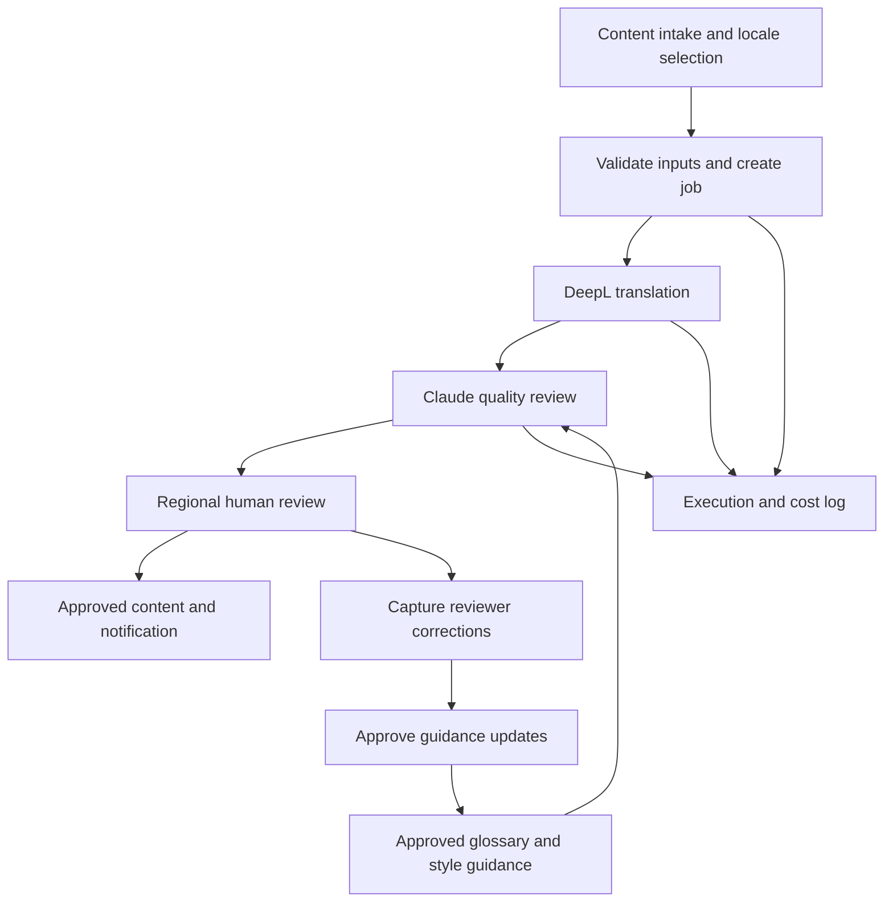
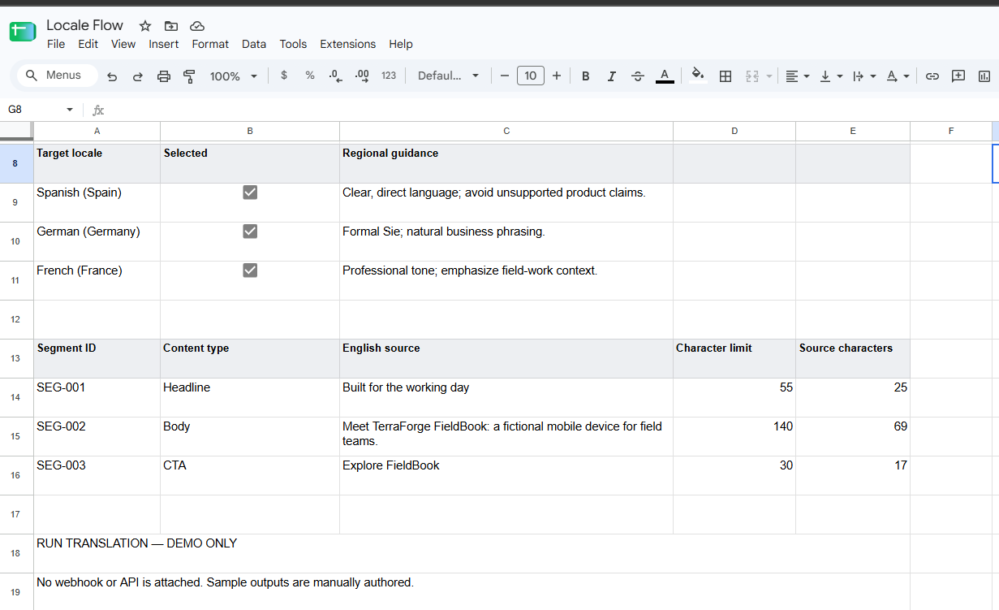
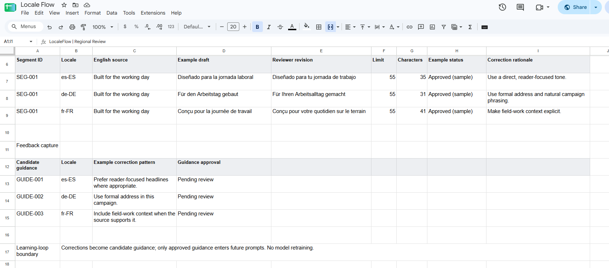
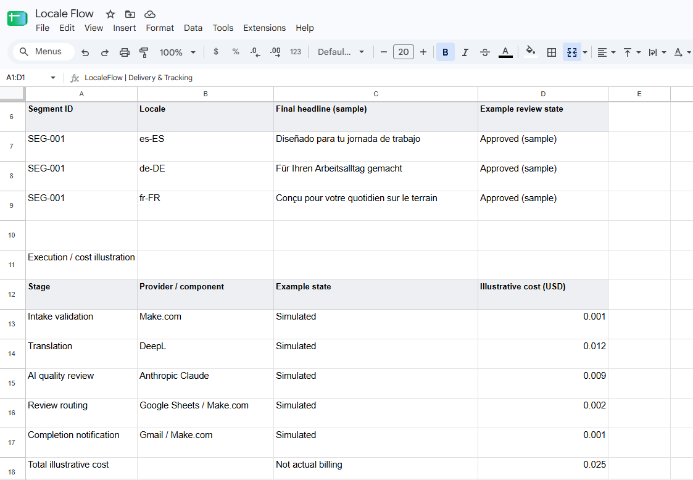

# LocaleFlow
### AI-Assisted Localization & Review Workflow

**Independent portfolio demonstration · Synthetic content and data**  
**Status:** Demonstration interfaces, architecture, and a written fictional source-to-approval example available.  
Based on experience designing and implementing a localization system currently used by a global marketing department.

## The Business Problem

A fictional B2B equipment company produces campaigns in English and adapts them for Spanish, German, and French markets.

Its manual process involves copying content between documents, checking terminology, coordinating reviewers, and consolidating approved versions. Reviewer corrections remain scattered, making them difficult to reuse.

LocaleFlow demonstrates an approach to coordinating this process through a shared workflow.

## My Role & Production Experience

I designed and implemented a localization and proofreading system that is now used by a global marketing department.

I gathered requirements from the headquarters team, built the workflows in Make.com and Google Sheets, and incorporated feedback from regional marketers. My responsibilities covered workflow design, configuration, testing, troubleshooting, and iteration.

The operational system supports:

- English content intake and task registration.
- Translation and delivery to regional reviewers.
- Review reminders and approved-content return.
- Terminology knowledge bases and regional guidelines.
- Reviewer-feedback capture for future AI context.
- Execution-cost logging.
- A central task log for tracking requests and progress.

### The Problem I Solved

Translation requests were spread across email threads, tools, and service providers. Regional marketers received overlapping requests, while headquarters had difficulty following the status of individual jobs.

I brought these activities into a coordinated Google Sheets and Make.com workflow, with a central task log and defined stages for submission, translation, proofreading, and delivery.

The resulting system gives the team a shared place to track work and coordinate the process.

### How LocaleFlow Represents This Experience

LocaleFlow is a separately created portfolio demonstration of these capabilities. Its fictional content, sample interfaces, and architecture illustrate my approach without reproducing the employer's implementation.

The screenshots show manually authored examples. They are not screenshots of the production system, and the portfolio demonstration is not connected to live automation.

## Proposed Workflow

1. **Submit content**  
   The campaign owner enters English copy, selects target locales, and provides content requirements.

2. **Translate**  
   DeepL generates initial translations while preserving the relationship between source and translated segments.

3. **Review with AI**  
   Claude checks drafts against locale-specific terminology, tone, and character limits. Items requiring human judgment are flagged.

4. **Route for regional review**  
   Reviewers receive drafts in their designated sheets, with source text and relevant instructions.

5. **Return approved content**  
   Reviewed segments are consolidated into the master sheet, with completion status and notifications.

6. **Capture feedback**  
   Reviewer changes become candidate glossary or style-guidance updates. Approved updates are supplied as context in subsequent runs.

## Architecture

## Design Considerations

| Concern | Planned approach |
|---|---|
| Traceability | Link each translated segment to a stable source ID |
| Duplicate runs | Track job state and prevent concurrent processing of the same job |
| Missing inputs | Validate source text, locale selections, and required fields |
| Character limits | Check limits and flag unresolved exceptions |
| API failures | Record failed stages and support controlled retries |
| Review ownership | Assign review destinations by locale |
| Cost visibility | Log available API usage and calculate estimated costs |
| Feedback quality | Require approval before corrections become reusable guidance |

## What the Feedback Loop Means

LocaleFlow does not retrain the underlying language models.

It captures reviewer corrections and turns approved patterns into reusable terminology or style guidance. Future AI calls receive that updated context.

## Demonstration Assets

Available assets include:

- A campaign-intake interface with fictional source copy and locale selections.
- A regional review interface showing sample drafts and reviewer edits.
- A delivery and tracking interface with sample approved translations and illustrative costs.
- A written fictional example tracing source copy, reviewer edits, approval, and candidate guidance.

See the Interface Walkthrough below. A live automation demonstration and video walkthrough remain planned.

## Fictional Example: From Source Copy to Approved Translation

**Manually authored illustration.** The text, review decisions, and task records below are fictional. They were not generated by a live DeepL or Claude execution and are not production records.

### Intake

| Field | Sample input |
|---|---|
| Job ID | DEMO-LOC-001 |
| Campaign | Field-team connectivity |
| Source language | English |
| Target locale | Spanish — illustrative regional style |
| Source copy | Keep field teams connected. |
| Example style guidance | Use a direct, friendly tone; prefer “equipos en terreno” for this campaign. |

The wording preference is invented for this demonstration, not an employer glossary rule.

### Draft, Review & Approval

| Stage | Manually authored sample |
|---|---|
| Initial translation draft | Mantén conectados a los equipos de campo. |
| Context-aware revision | Mantén conectados a los equipos en terreno. |
| Regional reviewer edit | Mantén conectados a tus equipos en terreno. |
| Review rationale | The reviewer keeps the campaign terminology and makes the line address the reader more directly. |
| Approved delivery | Mantén conectados a tus equipos en terreno. |

This example shows the roles of translation, contextual revision, and human judgment. It is not a comparison of model performance or a claim that one phrasing is universally preferable.

### Feedback & Delivery Record

| Field | Sample output |
|---|---|
| Job ID | DEMO-LOC-001 |
| Review status | Approved in this fictional example |
| Final content | Mantén conectados a tus equipos en terreno. |
| Candidate guidance | Consider direct second-person wording for this campaign. |
| Guidance approval | Pending human approval |
| Delivery status | Approved copy returned to the master record |
| Execution cost | Not measured — no API call was executed |

A reviewer edit can become a candidate guidance update. It does not automatically become a universal rule or retrain the language model. Once approved for the intended scope, guidance can be supplied as context in future runs.

## Technology Roles

| Technology | Role |
|---|---|
| Make.com | Workflow orchestration, routing, and API calls |
| Google Sheets | Intake, review interfaces, guidance, and tracking |
| DeepL | Initial translation |
| Anthropic Claude | Context-aware quality review and revision |
| Gmail | Review and completion notifications |

## Validation Plan

The demonstration will test:

- A successful job across three target locales.
- Missing source text and invalid configuration.
- Content exceeding a character limit.
- An API failure and recovery path.
- A reviewer correction followed by an approved guidance update.

Measured results will be added after testing. No measured time savings, quality improvements, or reliability results are claimed for the portfolio demonstration.

## Portfolio Disclosure

LocaleFlow is an independently designed demonstration using a fictional organization and synthetic data. It does not reproduce an employer's implementation or include internal content, prompts, business rules, or customer information.

## Interface Walkthrough

These screenshots show an independent demonstration using
fictional content and manually authored sample results.
No live automation is connected.

### 1. Campaign Intake
Select target languages and define source copy and character limits.

### 2. Regional Review
Compare translation drafts with reviewer edits and capture
feedback for future guidance.

### 3. Delivery & Tracking
View sample approved translations and illustrative execution costs.

