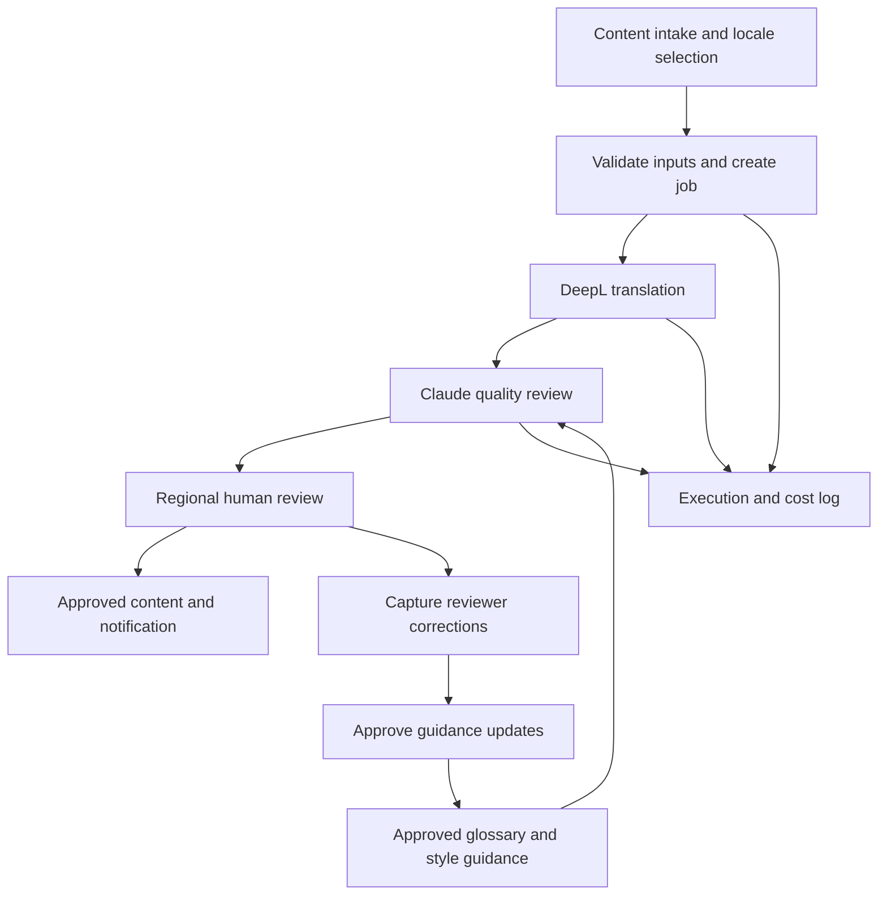

# LocaleFlow
### AI-Assisted Localization & Review Workflow

**Independent portfolio demonstration · Synthetic content and data**  
**Status:** Case-study design; implementation and demo assets forthcoming.

## The Business Problem

A fictional B2B equipment company produces campaigns in English and adapts them for Spanish, German, and French markets.

Its manual process involves copying content between documents, checking terminology, coordinating reviewers, and consolidating approved versions. Reviewer corrections remain scattered, making them difficult to reuse.

LocaleFlow demonstrates an approach to coordinating this process through a shared workflow.

## Proposed Workflow

1. **Submit content**  
   The campaign owner enters English copy, selects target locales, and provides content requirements.

2. **Translate**  
   DeepL generates initial translations while preserving the relationship between source and translated segments.

3. **Review with AI**  
   Claude checks drafts against locale-specific terminology, tone, and character limits. Items requiring human judgment are flagged.

4. **Route for regional review**  
   Reviewers receive drafts in their designated sheets, with source text and relevant instructions.

5. **Return approved content**  
   Reviewed segments are consolidated into the master sheet, with completion status and notifications.

6. **Capture feedback**  
   Reviewer changes become candidate glossary or style-guidance updates. Approved updates are supplied as context in subsequent runs.

## Architecture

## Design Considerations

| Concern | Planned approach |
|---|---|
| Traceability | Link each translated segment to a stable source ID |
| Duplicate runs | Track job state and prevent concurrent processing of the same job |
| Missing inputs | Validate source text, locale selections, and required fields |
| Character limits | Check limits and flag unresolved exceptions |
| API failures | Record failed stages and support controlled retries |
| Review ownership | Assign review destinations by locale |
| Cost visibility | Log available API usage and calculate estimated costs |
| Feedback quality | Require approval before corrections become reusable guidance |

## What the Feedback Loop Means

LocaleFlow does not retrain the underlying language models.

It captures reviewer corrections and turns approved patterns into reusable terminology or style guidance. Future AI calls receive that updated context.

## Demonstration Assets

Planned assets include:

- A master-sheet interface with content intake and job status.
- A regional review interface using fictional campaign copy.
- A source → draft → reviewer correction example.
- An execution log with illustrative usage and costs.
- A short walkthrough of a complete localization job.

## Technology Roles

| Technology | Role |
|---|---|
| Make.com | Workflow orchestration, routing, and API calls |
| Google Sheets | Intake, review interfaces, guidance, and tracking |
| DeepL | Initial translation |
| Anthropic Claude | Context-aware quality review and revision |
| Gmail | Review and completion notifications |

## Validation Plan

The demonstration will test:

- A successful job across three target locales.
- Missing source text and invalid configuration.
- Content exceeding a character limit.
- An API failure and recovery path.
- A reviewer correction followed by an approved guidance update.

Measured results will be added after testing. No time savings, quality improvements, or production reliability claims are made at this stage.

## Portfolio Disclosure

LocaleFlow is an independently designed demonstration using a fictional organization and synthetic data. It does not reproduce an employer's implementation or include internal content, prompts, business rules, or customer information.
