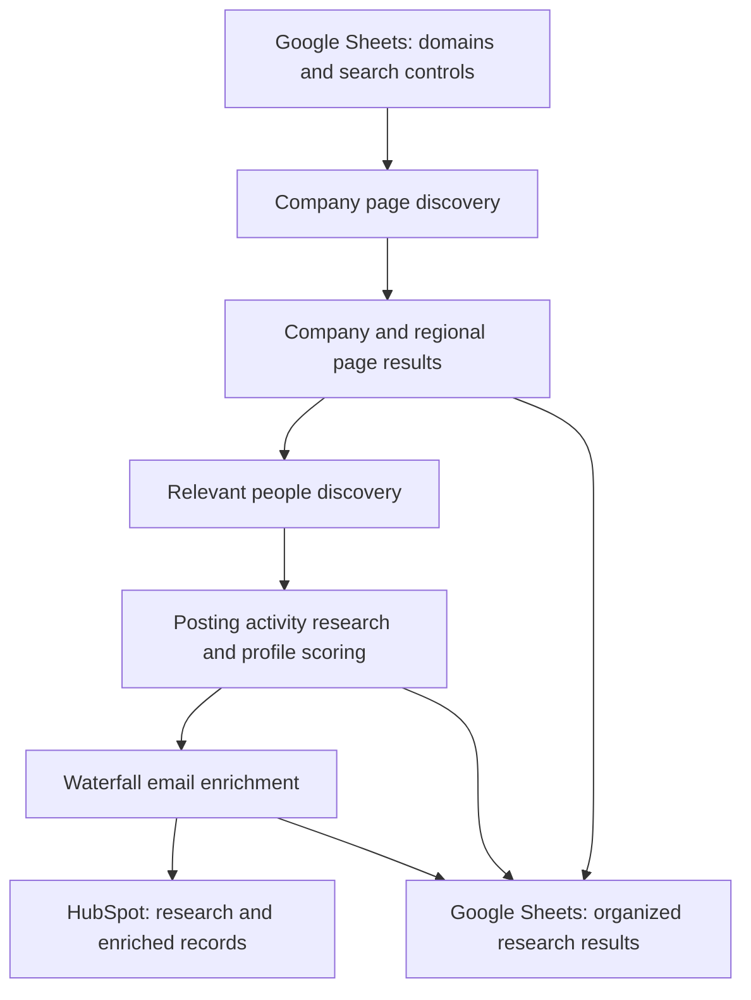

# ProspectFlow
### Company Discovery, Prospect Research & Email Enrichment

**Independent portfolio case study · Demonstration assets will use synthetic data**  
**Status:** Case-study overview available; fictional interfaces and demonstration results are being prepared.

## The Business Problem

B2B prospecting research is often scattered across company websites, LinkedIn pages, enrichment tools, spreadsheets, and CRM records.

Finding the right company page is only the beginning. Teams also need to distinguish regional entities, identify relevant people, understand their professional activity, prioritize profiles, and find contact details. When these steps are disconnected, useful research can remain outside the CRM.

## My Role & Professional Experience

I built a coordinated prospect-research and enrichment workflow using Google Sheets as the operating interface and Make.com for orchestration.

The workflow brings together domain-based company discovery, relevant-person searches, profile research and scoring, waterfall email enrichment, and CRM updates. Its connected stack includes Apify, Apollo, Perplexity, OpenAI, HubSpot, and 6sense.

This case study describes those capabilities at a high level. It does not publish employer-specific targeting rules, scoring weights, provider configurations, or internal implementation details.

## Workflow Overview

| Stage | Capability |
|---|---|
| Company discovery | Start from company domains and find relevant LinkedIn company pages, including regional variations and follower counts. |
| People discovery | Find relevant individuals using configurable targeting criteria. |
| Profile research | Research individuals' LinkedIn posting activity and summarize the topics discussed. |
| Profile scoring | Score profiles to help users prioritize targeting and review. |
| Waterfall enrichment | Use successive enrichment sources to look for contact email addresses. |
| CRM synchronization | Return research, scores, and enrichment results to HubSpot. |

Google Sheets organizes inputs, search controls, and results across these stages. HubSpot and 6sense are connected to the wider workflow; this overview intentionally leaves their account-specific configuration undisclosed.

## Conceptual Architecture

The diagram shows the business stages, rather than the employer's Make.com scenario or exact module configuration.

## What Makes This More Than a Contact List

- **Company context:** Regional page variations and follower counts provide additional context for company research.
- **Research for prioritization:** Profile scores and posting-topic summaries help users review relevance.
- **Coordinated enrichment:** Email discovery follows a waterfall approach across successive sources.
- **An accessible operating interface:** Google Sheets gives users a shared place to organize searches and inspect results.
- **CRM continuity:** Findings flow back to HubSpot so the research is available beyond the spreadsheet.

## Technology Roles

| Technology | Role in the connected stack |
|---|---|
| Google Sheets | Operating interface for inputs, search controls, and research results |
| Make.com | Workflow orchestration and API integrations |
| Apify | LinkedIn company and individual-profile data collection |
| Apollo | Contact and email enrichment |
| Perplexity | Research support |
| OpenAI | AI-assisted analysis, classification, and scoring |
| HubSpot | Destination for CRM research and enrichment updates |
| 6sense | Connected company and intent-data platform |

The table describes broad roles, not the exact provider order or internal integration configuration.

## Demonstration Assets — Planned

The independent demonstration will use fictional organizations and synthetic contact records to illustrate:

1. Domain intake and company discovery, including regional variations.
2. A prospect shortlist with illustrative scores and posting-topic summaries.
3. Waterfall enrichment outcomes, including contacts with no email found.
4. A sample CRM handoff showing the research fields returned.

No live employer records, real contact email addresses, proprietary scoring criteria, or internal screenshots will be used.

## Evidence & Results

This page currently documents scope and professional responsibilities. Demonstration screenshots and validation results will be added separately.

No numerical claims about time savings, email accuracy, deliverability, or sales performance are made here. Finding an email address does not by itself establish that the address is verified.

## Portfolio Disclosure

ProspectFlow is the portfolio name for an independently presented case study of my automation capabilities. Any accompanying demo interfaces and records will be separately created using synthetic data.

The conceptual architecture does not reproduce an employer's implementation. Internal content, credentials, prompts, targeting rules, customer information, and proprietary business logic are excluded.

[Back to portfolio](../../README.md)
