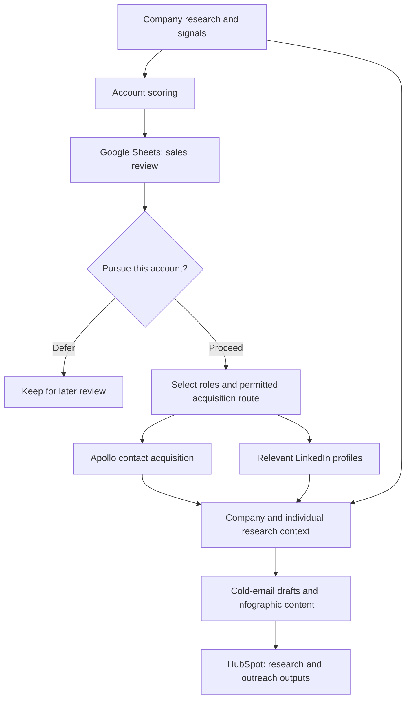

# SignalFlow
### AI Account Scoring & Outreach Preparation

**Company intelligence → sales review → contact acquisition → personalized outreach drafts**

**Status:** Case-study overview and conceptual architecture available. Independent demo visuals and sample outputs are planned.

## The Business Problem

Sales teams need to decide which companies deserve attention before investing time in contact research and outreach.

Company signals, account research, contact details, and content preparation often sit in separate tools. A ranked account list alone does not give sales everything needed to act: teams still need to review the opportunity, select relevant roles, choose an approved contact-acquisition route, and prepare a relevant message.

## My Role

I built a coordinated workflow that scores companies using multiple signals, presents priority accounts for sales review, and lets sales trigger the next research and contact-acquisition steps.

I connected Make.com, Google Sheets, Apollo, HubSpot, Apify, OpenAI, and Perplexity to bring company research, individual profile context, and outreach preparation into one process.

My work covered workflow orchestration, the Google Sheets operating interface, research and scoring logic, contact acquisition, AI-assisted content preparation, and CRM synchronization.

## Workflow Overview

| Stage | What happens | Result |
|---|---|---|
| Company research | Gather company information and signals for evaluation. | Account research context |
| Account scoring | Apply defined criteria to prioritize companies. | Ranked companies for sales review |
| Sales review | Sales reviews priority accounts and selects relevant job profiles. | A decision on which accounts and roles to pursue |
| Contact acquisition | Sales can trigger Apollo contact acquisition where permitted by the organization's compliance process, or retrieve relevant LinkedIn profiles for profile-based contact. | Contact details or profile links |
| Outreach preparation | Use company research and individual profile context to prepare cold-email drafts and infographic content. | Research-informed outreach assets |
| CRM synchronization | Sync research, contact information, and prepared outreach outputs to HubSpot. | CRM records with supporting context |

Google Sheets serves as the operating interface. Make.com coordinates the connected tools and passes context between stages.

## Conceptual Architecture

This diagram describes the business process at a high level; it is not a reproduction of an internal Make.com scenario.

## Sales Control & Contact Acquisition

Sales reviews the prioritized companies before triggering contact acquisition and selects the job profiles considered relevant.

The contact-acquisition route depends on the organization's applicable compliance review and permissions. The workflow does not itself establish GDPR compliance or permission to send outreach.

This case study covers outreach preparation and CRM synchronization. Automated email sending is outside the scope described here.

## Research-Informed Content

The content stage combines company research with individual profile context to prepare outreach for the selected audience.

Outputs include:

- Cold-email drafts informed by account and person research.
- Infographic content supporting the outreach message.
- Research and prepared outputs synchronized to the CRM.

The format of visual infographic deliverables will be documented with future demo assets. No finished-design or file-export capability is claimed by this overview.

## Technology Roles

| Technology | Role |
|---|---|
| Make.com | Orchestration and connected workflow stages |
| Google Sheets | Account review, workflow controls, and organized research |
| Apollo | Contact acquisition and enrichment |
| HubSpot | CRM synchronization of research and outreach outputs |
| Apify | Profile and supporting data collection |
| OpenAI | AI-assisted analysis and content preparation |
| Perplexity | Research supporting account and outreach context |

Exact scoring weights, prompts, source configurations, and employer-specific targeting rules are omitted.

## How This Differs from ProspectFlow

[ProspectFlow](../prospectflow/README.md) focuses on finding companies and individuals, researching profiles, and enriching contact records.

SignalFlow starts with account prioritization and sales review, then connects selected accounts to contact acquisition and personalized outreach preparation. Its central value is carrying research context from the company score through to the prepared message.

## Planned Portfolio Demonstration

Independent assets will use fictional companies, synthetic profiles, and illustrative scores:

1. An account-scoring and sales-review interface.
2. A sales-triggered contact-acquisition walkthrough.
3. A company-and-person research summary.
4. A cold-email draft and infographic-content example.
5. A sample CRM record showing the resulting research and outreach outputs.

These assets are planned, not screenshots or results from a completed public demo.

## Evidence & Disclosure

This overview describes professional work reported by the builder. It does not claim measured improvements in conversion, revenue, response rates, or time savings.

SignalFlow is a portfolio project name. Public demonstrations will be independently created and will exclude employer records, customer data, credentials, proprietary scoring criteria, internal prompts, and confidential implementation details.

[Back to portfolio](../../README.md)
