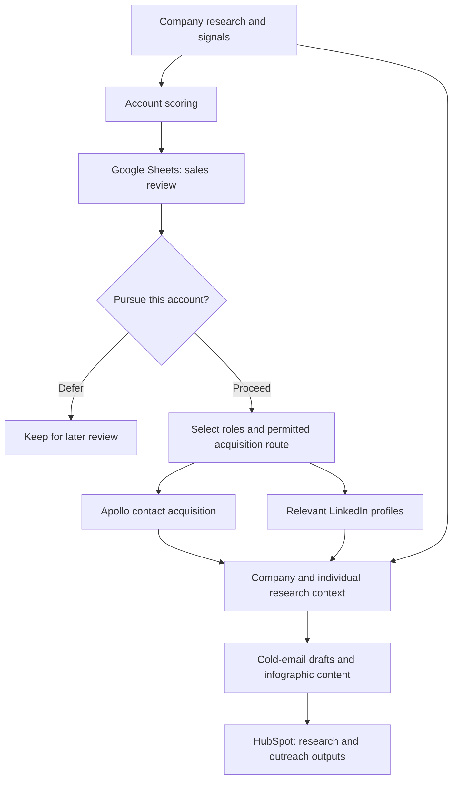
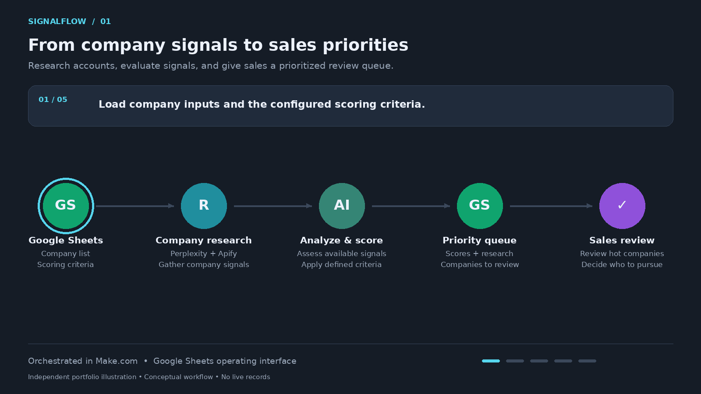
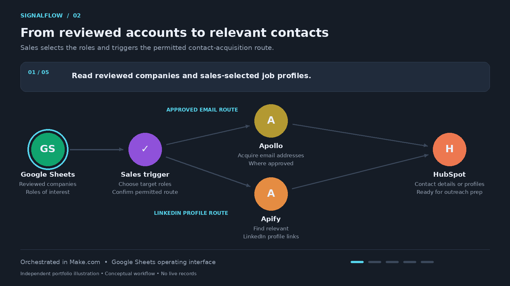
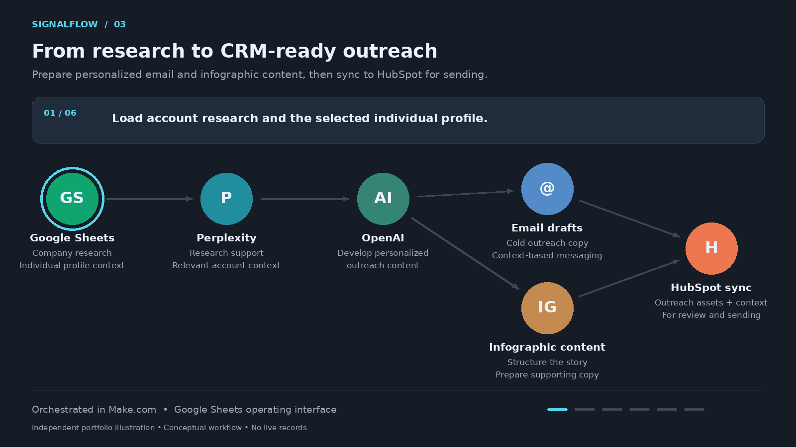

# SignalFlow
### AI Account Scoring & Outreach Preparation

**Company intelligence → sales review → contact acquisition → personalized outreach drafts**

**Status:** Case-study overview, conceptual architecture, and three animated workflow walkthroughs available. A written fictional example includes a research summary, priority assessment, email draft, infographic brief, and sample CRM handoff. Executable demos and interface examples remain planned.

## The Business Problem

Sales teams need to decide which companies deserve attention before investing time in contact research and outreach.

Company signals, account research, contact details, and content preparation often sit in separate tools. A ranked account list alone does not give sales everything needed to act: teams still need to review the opportunity, select relevant roles, choose an approved contact-acquisition route, and prepare a relevant message.

## My Role

I built a coordinated workflow that scores companies using multiple signals, presents priority accounts for sales review, and lets sales trigger the next research and contact-acquisition steps.

I connected Make.com, Google Sheets, Apollo, HubSpot, Apify, OpenAI, and Perplexity to bring company research, individual profile context, and outreach preparation into one process.

My work covered workflow orchestration, the Google Sheets operating interface, research and scoring logic, contact acquisition, AI-assisted content preparation, and CRM synchronization.

## Workflow Overview

| Stage | What happens | Result |
|---|---|---|
| Company research | Gather company information and signals for evaluation. | Account research context |
| Account scoring | Apply defined criteria to prioritize companies. | Ranked companies for sales review |
| Sales review | Sales reviews priority accounts and selects relevant job profiles. | A decision on which accounts and roles to pursue |
| Contact acquisition | Sales can trigger Apollo contact acquisition where permitted by the organization's compliance process, or retrieve relevant LinkedIn profiles for profile-based contact. | Contact details or profile links |
| Outreach preparation | Use company research and individual profile context to prepare cold-email drafts and infographic content. | Research-informed outreach assets |
| CRM synchronization | Sync research, contact information, and prepared outreach outputs to HubSpot. | CRM records with supporting context |

Google Sheets serves as the operating interface. Make.com coordinates the connected tools and passes context between stages.

## Conceptual Architecture

This diagram describes the business process at a high level; it is not a reproduction of an internal Make.com scenario.

## Sales Control & Contact Acquisition

Sales reviews the prioritized companies before triggering contact acquisition and selects the job profiles considered relevant.

The contact-acquisition route depends on the organization's applicable compliance review and permissions. The workflow does not itself establish GDPR compliance or permission to send outreach.

This case study covers outreach preparation and CRM synchronization. Automated email sending is outside the scope described here.

## Research-Informed Content

The content stage combines company research with individual profile context to prepare outreach for the selected audience.

Outputs include:

- Cold-email drafts informed by account and person research.
- Infographic content supporting the outreach message.
- Research and prepared outputs synchronized to the CRM.

A written infographic-content brief is included in the fictional example below. Visual-design and file-export demonstrations remain planned.

## Technology Roles

| Technology | Role |
|---|---|
| Make.com | Orchestration and connected workflow stages |
| Google Sheets | Account review, workflow controls, and organized research |
| Apollo | Contact acquisition and enrichment |
| HubSpot | CRM synchronization of research and outreach outputs |
| Apify | Profile and supporting data collection |
| OpenAI | AI-assisted analysis and content preparation |
| Perplexity | Research supporting account and outreach context |

Exact scoring weights, prompts, source configurations, and employer-specific targeting rules are omitted.

## How This Differs from ProspectFlow

[ProspectFlow](../prospectflow/README.md) focuses on finding companies and individuals, researching profiles, and enriching contact records.

SignalFlow starts with account prioritization and sales review, then connects selected accounts to contact acquisition and personalized outreach preparation. Its central value is carrying research context from the company score through to the prepared message.

## Animated Workflow Walkthroughs

These looping animations illustrate the business process using independently created visuals. They contain no live records, internal screenshots, or proprietary configurations.

### 1. Account Scoring & Sales Review

Company inputs and scoring criteria are organized in Google Sheets. Company research and available signals feed analysis and account scoring, then a priority queue gives sales the context to review which companies to pursue.

### 2. Contact Acquisition

Sales selects the roles of interest and triggers the permitted acquisition route. The email route uses Apollo; the profile route retrieves relevant LinkedIn profiles through Apify. Available contact details or profile links synchronize to HubSpot for outreach preparation.

### 3. Outreach Content & CRM Synchronization

Company research and individual profile context support personalized cold-email drafts and infographic content. The prepared outputs synchronize to HubSpot for review and sending through the team's established process.

## Fictional Example: From Company Signals to Outreach Draft

**Manually authored illustration.** All company facts, people, project signals, activity themes, and review decisions below are invented. No live research, scoring execution, enrichment, CRM update, or email send occurred. The example criteria are independent of employer scoring rules.

### 1. Company Research Input

| Field | Synthetic scenario |
|---|---|
| Company | Harborline Water Services |
| Domain | harborline.example — placeholder only |
| Business context | Utility field maintenance |
| Project signal | Planning an inspection-workflow pilot |
| Operational context | Technicians record observations at remote pump stations |
| Process need | Consistent inspection records and clearer maintenance handoffs |
| Person of interest | Lena Cruz, Director of Field Operations — fictional |
| Professional activity | A sample post discusses offline inspection forms; this is invented context, not a retrieved post. |

The fictional offer for this example is help designing a field-inspection workflow. These are scenario inputs, not verified company claims.

### 2. Illustrative Priority Assessment

| Dimension | Example assessment | Reason |
|---|---|---|
| Use-case relevance | Strong | The inspection process aligns with the fictional offer. |
| Project timing | Worth reviewing | A pilot is being planned in the scenario. |
| Role relevance | Strong | Field operations leadership is involved in the process. |
| Evidence quality | Synthetic only | No real research has been performed. |
| Overall queue position | High — illustrative | Present to sales for a decision, not an automatic acquisition trigger. |

No numeric weights or proprietary scoring thresholds are disclosed or implied.

### 3. Sales Decision & Contact Route

| Decision | Sample action |
|---|---|
| Account review | Sales selects the account for follow-up preparation. |
| Roles to pursue | Field operations leadership |
| Acquisition route | Apollo contact acquisition only after the organization's required approval; otherwise use the profile-based route. |
| Example branch | LinkedIn profile reference selected; email acquisition not triggered. |
| Email address | Blank |
| Next step | Prepare content for review without treating the record as ready for email sending. |

This makes the human decision visible between the company priority and contact acquisition.

### 4. Prepared Cold-Email Draft

The following draft demonstrates how the fictional research context can shape a message. It is prepared copy only: the example has no acquired email address or sending authorization.

**Subject:** A workflow map for your inspection pilot

> Hi Lena,
>
> For the pump-station inspection pilot you're planning, the transition from field observations to maintenance follow-up looks like a useful place to start.
>
> I could help map how technicians capture findings, how those findings reach the right team, and how follow-up status is recorded. We could use that map to define the pilot requirements before choosing the implementation.
>
> Would a one-page draft of that workflow be useful?
>
> David

The draft connects a specific operational use case to a small next step. It introduces no invented performance gains, product capabilities, customer references, or claims of previous contact.

### 5. Infographic Content Brief

**Working title:** From Field Inspection to Maintenance Follow-Up  
**Audience:** Field operations and maintenance leads  
**Purpose:** Make the proposed pilot workflow easy to review.

| Panel | Prepared copy | Suggested visual |
|---|---|---|
| Capture | Record the location, finding, and supporting notes during the inspection. | Inspection-form icon |
| Organize | Structure the observation so the receiving team has the context it needs. | Organized-record card |
| Assign | Route the finding to the responsible maintenance team. | Assignment arrow |
| Follow through | Record progress and return a visible status update. | Status checklist |

**Closing question:** “Which handoff should the pilot improve first?”

This is an editorial brief and copy outline, not a finished infographic file or a live generated asset. It describes a proposed process rather than claiming the prospect already uses it.

### 6. Example CRM Handoff

| Field | Illustrative value |
|---|---|
| Company | Harborline Water Services |
| Research status | Synthetic portfolio example |
| Priority | High — illustrative |
| Sales decision | Selected for preparation |
| Contact route | Profile-based; email not acquired |
| Person / role | Lena Cruz / Director of Field Operations |
| Email draft | Prepared for human review |
| Infographic brief | Prepared for human review |
| Send readiness | Not ready: no acquired email address or recorded approval in this example |
| Actual CRM sync | Not executed |

The example carries account and person context through to reviewable content while keeping acquisition, content preparation, and sending as distinct decisions.

## Executable Demonstration — Planned

Future executable and interface assets will complement the manually authored example using fictional companies, synthetic profiles, and illustrative scores:

1. An account-scoring and sales-review interface.
2. A sample contact-acquisition interface complementing the animated walkthrough.
3. A company-and-person research summary.
4. A cold-email draft and infographic-content example.
5. A sample CRM record showing the resulting research and outreach outputs.

These executable and interface assets remain planned. The written samples above are available and explicitly labeled as manually authored.

## Evidence & Disclosure

This overview describes professional work reported by the builder. It does not claim measured improvements in conversion, revenue, response rates, or time savings.

SignalFlow is a portfolio project name. Public demonstrations will be independently created and will exclude employer records, customer data, credentials, proprietary scoring criteria, internal prompts, and confidential implementation details.

[Back to portfolio](../../README.md)
